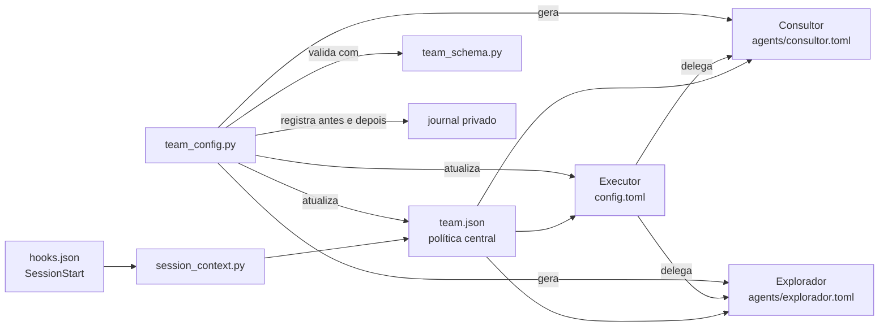

# Configuração manual de modelos

Este guia mostra como trocar modelos e esforços sem usar a skill interativa. O
procedimento continua usando o configurador do plugin para validar a política,
atualizar todos os arquivos relacionados e preservar os backups.

> **Não edite os arquivos gerados isoladamente.** Alterar diretamente
> `config.toml`, `agents/*.toml` ou o journal pode deixar a política
> inconsistente e impedir uma atualização ou remoção posterior.

## Mapa dos arquivos

`CODEX_HOME` normalmente é `~/.codex`. Se a variável estiver configurada, use o
diretório indicado por ela.

```text
$CODEX_HOME/
├── personal-agent-team-codex/
│   └── team.json                  # fonte principal da política
├── agents/
│   ├── consultor.toml             # agente executável do consultor
│   └── explorador.toml            # agente executável do explorador, se configurado
├── config.toml                    # modelo do executor e concorrência
└── personal-agent-team-codex-state.json
                                    # backup privado e controle de alterações

plugins/personal-agent-team-codex/
├── hooks/hooks.json               # inicia o carregamento da política
└── scripts/
    ├── session_context.py         # transforma team.json em instruções
    ├── team_config.py             # plan, apply, resolve e uninstall
    └── team_schema.py             # valida estrutura e referências
```

Os caminhos dentro de `plugins/` são relativos a uma cópia deste repositório. O
cache interno do Codex contém os mesmos arquivos, mas seu caminho inclui a versão
instalada e pode mudar após uma atualização.

## O que cada arquivo controla

### `personal-agent-team-codex/team.json`

É a especificação canônica da equipe. As principais seções são:

- `levels`: modelo, esforço e alternativas de cada nível;
- `agents`: nível padrão, nível máximo, delegação, permissão solicitada e
  instruções de cada agente;
- `workflow`: fluxo ativo e suas etapas;
- `limits`: concorrência e orçamento orientativo de chamadas;
- `project_overrides`: substituições pessoais por caminho absoluto de projeto.

Os agentes apontam para níveis. Portanto, trocar o modelo de um nível afeta todos
os agentes que usam esse nível como padrão ou o selecionam durante uma tarefa.

### `config.toml`

O executor é a própria conversa principal e não possui
`agents/executor.toml`. O configurador grava em `config.toml` o modelo e o
esforço correspondentes ao `default_level` do executor. Quando configurada, a
concorrência também é registrada nesse arquivo.

Esse arquivo pode conter tokens, endpoints e configurações de serviços. Não o
publique nem copie seu conteúdo completo para relatórios.

### `agents/<nome>.toml`

Cada subagente possui um TOML gerado a partir de `team.json`. Ele contém modelo,
esforço, sandbox solicitado e instruções executáveis. Acionamentos, workflows e
contratos de resposta permanecem na política central e são carregados pelo hook.

Uma permissão `read-only` é uma solicitação. Confirme o sandbox efetivo pelos
metadados da execução antes de tratar o agente como tecnicamente isolado.

### `personal-agent-team-codex-state.json`

É o journal privado usado para detectar alterações externas e restaurar os
arquivos anteriores durante a remoção. Ele pode conter uma cópia de
`config.toml`, inclusive dados confidenciais. Não o edite nem compartilhe.

## Trocar modelos com segurança

Execute os comandos a partir da raiz de uma cópia deste repositório.
O configurador requer Python 3.11 ou superior, pois usa `tomllib` da biblioteca
padrão. Confira o interpretador antes de continuar:

```sh
python3 --version
```

### 1. Copie a política ativa

Crie uma cópia privada em um caminho temporário exclusivo. Mantenha a mesma
sessão do terminal para usar a variável `manual_spec` nos passos seguintes.

```sh
manual_spec=$(mktemp "${TMPDIR:-/tmp}/personal-agent-team.XXXXXX")
chmod 600 "$manual_spec"
cp "${CODEX_HOME:-$HOME/.codex}/personal-agent-team-codex/team.json" "$manual_spec"
```

Se ainda não houver uma equipe, gere uma especificação inicial:

```sh
manual_spec=$(mktemp "${TMPDIR:-/tmp}/personal-agent-team.XXXXXX")
chmod 600 "$manual_spec"
python3 plugins/personal-agent-team-codex/scripts/team_config.py defaults > "$manual_spec"
```

### 2. Edite somente a cópia

Abra o caminho armazenado em `manual_spec` e altere os campos desejados em
`levels`. Para exibir o caminho:

```sh
echo "$manual_spec"
```

Exemplo da seção a editar:

```json
{
  "levels": {
    "rotina": {
      "model": "MODELO_ROTINA",
      "effort": "low",
      "fallbacks": []
    },
    "analise": {
      "model": "MODELO_ANALISE",
      "effort": "medium",
      "fallbacks": []
    },
    "critico": {
      "model": "MODELO_CRITICO",
      "effort": "high",
      "fallbacks": []
    },
    "estrategico": {
      "model": "MODELO_ESTRATEGICO",
      "effort": "xhigh",
      "fallbacks": []
    }
  }
}
```

O trecho acima é ilustrativo. Preserve as demais seções da especificação real.
Os esforços aceitos pelo schema atual são `none`, `minimal`, `low`, `medium`,
`high`, `xhigh`, `max` e `ultra`, mas cada modelo pode aceitar apenas parte
deles. Confirme a disponibilidade e o esforço suportado no catálogo do Codex da
máquina.

Para mudar qual nível um agente utiliza, altere `default_level` em `agents`. O
valor não pode ultrapassar o `max_level` daquele agente.

### 3. Valide sem escrever

```sh
python3 plugins/personal-agent-team-codex/scripts/team_config.py \
  plan --spec "$manual_spec"
```

O comando deve terminar com sucesso e mostrar a prévia dos agentes, limites,
workflow, acionamentos obrigatórios e arquivos que serão atualizados.

### 4. Aplique a especificação validada

```sh
python3 plugins/personal-agent-team-codex/scripts/team_config.py \
  apply --spec "$manual_spec"
```

O configurador atualiza de forma coordenada:

- `personal-agent-team-codex/team.json`;
- modelo e esforço do executor em `config.toml`;
- TOMLs dos subagentes em `agents/`;
- journal privado de restauração.

Se houver uma alteração posterior em algum arquivo gerenciado, tanto `plan`
quanto `apply` recusam continuar. Nesse caso, compare a configuração atual com o
journal e concilie a mudança antes de tentar novamente. Não apague o journal para
contornar a proteção.

## Configuração diferente por projeto

Use `project_overrides` quando um projeto precisar de modelos ou esforços
diferentes. A chave deve ser o caminho absoluto do projeto:

```json
{
  "project_overrides": {
    "/caminho/absoluto/do/projeto": {
      "levels": {
        "estrategico": {
          "model": "MODELO_ESTRATEGICO_DO_PROJETO",
          "effort": "high",
          "fallbacks": []
        }
      }
    }
  }
}
```

O override mais específico é aplicado. Overrides de diretórios ancestrais não
são combinados automaticamente com o vencedor.

Overrides representam a política desejada para aquela árvore de projeto. O
`apply` gera `config.toml` e `agents/*.toml` a partir dos níveis globais; o hook
carrega no contexto a política efetiva do projeto, mas não reescreve esses TOMLs
a cada conversa. Portanto, um override de modelo não é prova de que o runtime
lançou o agente com aquele modelo. Use `resolve` para inspecionar a seleção
esperada e confirme a execução real pelos metadados da chamada.

## Verificar a configuração efetiva

Resolva um agente para o projeto desejado:

```sh
python3 plugins/personal-agent-team-codex/scripts/team_config.py \
  resolve \
  --cwd "/caminho/absoluto/do/projeto" \
  --agent consultor
```

Depois, abra uma conversa nova no Codex. O hook `SessionStart` carrega a política
no início da sessão e após compactações. Conversas já abertas podem continuar com
o contexto anterior.

Para validar a execução real, faça um pedido explícito de consulta e confira nos
metadados da chamada:

- agente chamado;
- modelo e esforço efetivos;
- sandbox observado;
- formato e resultado da resposta.

O conteúdo declarado pelo próprio agente não prova sua identidade ou permissão.
O resultado de `resolve` também não prova a execução. Use os metadados fornecidos
pelo runtime para confirmar modelo, esforço e sandbox efetivos.

## Fluxo de carregamento


