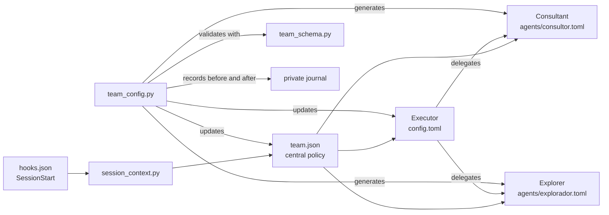

# Manual model configuration

This guide explains how to change models and reasoning efforts without the
interactive skill. The procedure still uses the plugin configurator to validate
the policy, update related files, and preserve backups.

> **Do not edit generated files independently.** Direct changes to `config.toml`,
> `agents/*.toml`, or the journal can leave the policy inconsistent and prevent
> a later update or removal.

## File map

`CODEX_HOME` defaults to `~/.codex`. If the environment variable is configured,
use the directory it specifies.

```text
$CODEX_HOME/
├── personal-agent-team-codex/
│   └── team.json                  # main policy source
├── agents/
│   ├── consultor.toml             # executable consultant agent
│   └── explorador.toml            # executable explorer agent, if configured
├── config.toml                    # executor model and concurrency
└── personal-agent-team-codex-state.json
                                    # private backup and change tracking

plugins/personal-agent-team-codex/
├── hooks/hooks.json               # starts policy loading
└── scripts/
    ├── session_context.py         # turns team.json into instructions
    ├── team_config.py             # plan, apply, resolve, and uninstall
    └── team_schema.py             # validates structure and references
```

Paths under `plugins/` are relative to a copy of this repository. The internal
Codex cache contains the same files, but its path includes the installed version
and can change after an update.

## What each file controls

### `personal-agent-team-codex/team.json`

This is the canonical team specification. Its main sections are:

- `levels`: model, effort, and fallbacks for each level;
- `agents`: default level, maximum level, delegation, requested permission, and
  instructions for each agent;
- `workflow`: active workflow and its steps;
- `limits`: concurrency and advisory call budget;
- `project_overrides`: personal overrides keyed by absolute project path.

Agents refer to levels. Changing a level's model therefore affects every agent
that uses that level by default or selects it during a task.

### `config.toml`

The executor is the main conversation itself and has no `agents/executor.toml`.
The configurator writes the model and effort corresponding to the executor's
`default_level` into `config.toml`. When configured, concurrency is also recorded
in this file.

This file may contain tokens, endpoints, and service configuration. Do not publish
it or copy its complete contents into reports.

### `agents/<name>.toml`

Each subagent has a TOML generated from `team.json`. It contains the model,
effort, requested sandbox, and executable instructions. Triggers, workflows, and
response contracts remain in the central policy and are loaded by the hook.

A `read-only` permission is a request. Confirm the effective sandbox through
execution metadata before treating the agent as technically isolated.

### `personal-agent-team-codex-state.json`

This private journal detects external changes and restores previous files during
removal. It may contain a copy of `config.toml`, including confidential data.
Do not edit or share it.

## Change models safely

Run these commands from the root of a copy of this repository. The configurator
requires Python 3.11 or later because it uses the standard library's `tomllib`.
Check the interpreter before continuing:

```sh
python3 --version
```

### 1. Copy the active policy

Create a private copy at a unique temporary path. Keep the same terminal session
so you can use `manual_spec` in the following steps.

```sh
manual_spec=$(mktemp "${TMPDIR:-/tmp}/personal-agent-team.XXXXXX")
chmod 600 "$manual_spec"
cp "${CODEX_HOME:-$HOME/.codex}/personal-agent-team-codex/team.json" "$manual_spec"
```

If no team exists yet, generate an initial specification:

```sh
manual_spec=$(mktemp "${TMPDIR:-/tmp}/personal-agent-team.XXXXXX")
chmod 600 "$manual_spec"
python3 plugins/personal-agent-team-codex/scripts/team_config.py defaults > "$manual_spec"
```

### 2. Edit only the copy

Open the path stored in `manual_spec` and change the desired fields in `levels`.
To display the path:

```sh
echo "$manual_spec"
```

Example of the section to edit:

```json
{
  "levels": {
    "rotina": {
      "model": "ROUTINE_MODEL",
      "effort": "low",
      "fallbacks": []
    },
    "analise": {
      "model": "ANALYSIS_MODEL",
      "effort": "medium",
      "fallbacks": []
    },
    "critico": {
      "model": "CRITICAL_MODEL",
      "effort": "high",
      "fallbacks": []
    },
    "estrategico": {
      "model": "STRATEGIC_MODEL",
      "effort": "xhigh",
      "fallbacks": []
    }
  }
}
```

This snippet is illustrative. Preserve the remaining sections of the actual
specification. The level keys `rotina`, `analise`, `critico`, and `estrategico`
are schema identifiers and must keep their original spelling.

The current schema accepts efforts `none`, `minimal`, `low`, `medium`, `high`,
`xhigh`, `max`, and `ultra`, but each model may support only some of them. Confirm
availability and supported efforts in the machine's Codex model catalog.

To change the level an agent uses, edit `default_level` in `agents`. It cannot
exceed that agent's `max_level`.

### 3. Validate without writing

```sh
python3 plugins/personal-agent-team-codex/scripts/team_config.py \
  plan --spec "$manual_spec"
```

The command should succeed and show a preview of agents, limits, workflow,
mandatory triggers, and files to be updated.

### 4. Apply the validated specification

```sh
python3 plugins/personal-agent-team-codex/scripts/team_config.py \
  apply --spec "$manual_spec"
```

The configurator updates these files together:

- `personal-agent-team-codex/team.json`;
- executor model and effort in `config.toml`;
- subagent TOMLs in `agents/`;
- the private restoration journal.

If a managed file has been changed afterward, both `plan` and `apply` refuse to
continue. Compare the current configuration with the journal and reconcile the
change before retrying. Do not delete the journal to bypass this protection.

## Different configuration per project

Use `project_overrides` when a project needs different models or efforts. The key
must be the project's absolute path:

```json
{
  "project_overrides": {
    "/absolute/path/to/project": {
      "levels": {
        "estrategico": {
          "model": "PROJECT_STRATEGIC_MODEL",
          "effort": "high",
          "fallbacks": []
        }
      }
    }
  }
}
```

The most specific override is applied. Overrides for ancestor directories are
not automatically combined with the winning override.

Overrides represent the desired policy for that project tree. `apply` generates
`config.toml` and `agents/*.toml` from global levels; the hook loads the effective
project policy into context but does not rewrite those TOMLs for each
conversation. A model override therefore does not prove that the runtime launched
the agent with that model. Use `resolve` to inspect the expected selection and
confirm actual execution through call metadata.

## Verify the effective configuration

Resolve an agent for the desired project:

```sh
python3 plugins/personal-agent-team-codex/scripts/team_config.py \
  resolve \
  --cwd "/absolute/path/to/project" \
  --agent consultor
```

Then open a new conversation in Codex. The `SessionStart` hook loads the policy
at session start and after compaction. Existing conversations may retain their
previous context.

To validate actual execution, explicitly request a consultation and check the
call metadata for:

- the agent called;
- effective model and effort;
- observed sandbox;
- response format and outcome.

An agent's own declarations do not prove its identity or permissions. The result
of `resolve` does not prove execution either. Use runtime metadata to confirm the
effective model, effort, and sandbox.

## Loading flow


